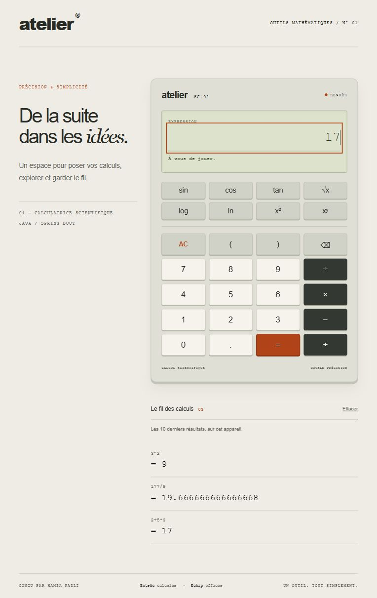

# Atelier — Calculatrice scientifique

Une calculatrice web en Java 17 et Spring Boot, avec un moteur d’analyse d’expressions écrit à la main et une interface inspirée des instruments de bureau.

Projet de **Fadli Hamza**.



## Démarrer

Prérequis : JDK 17 ou supérieur et Maven 3.6 ou supérieur.

```sh
git clone https://github.com/7amzvv/calculatrice-scientifique.git
cd calculatrice-scientifique
mvn test
mvn spring-boot:run
```

Ouvrir http://localhost:8080. Le serveur Java est nécessaire aux calculs : ouvrir le fichier HTML seul ne suffit pas.

## Utilisation

Saisir une expression au clavier ou utiliser les touches. Entrée lance le calcul, Échap efface l’expression. Les boutons insèrent à la position du curseur et remplacent la sélection.

| Expression | Résultat |
| --- | --- |
| `2+5*3` | `17` |
| `(2+5)*3` | `21` |
| `-2^2` | `-4` |
| `(-2)^2` | `4` |
| `2^-2` | `0.25` |
| `2^3^2` | `512` |
| `sqrt(81)+sin(30)` | environ `9.5` |
| `2e3+1` | `2001` |

Fonctions : `sqrt`, `sin`, `cos`, `tan`, `log` (base 10), `ln`. La trigonométrie utilise les **degrés**. Les appels nécessitent des parenthèses. Utiliser `.` comme séparateur décimal et `*` pour la multiplication : `2*(3+4)`.

Les dix derniers calculs réussis sont conservés dans le stockage local du navigateur. Cliquer sur une ligne réutilise son résultat ; « Effacer » vide l’historique. Si le stockage est indisponible, l’historique reste utilisable pendant la session.

## Architecture

- `src/main/java/com/calculatrice/service/ServiceCalculatrice.java` : analyse et évaluation des expressions.
- `src/main/java/com/calculatrice/controller/` : contrat JSON et endpoint REST.
- `src/main/resources/static/` : interface HTML, CSS et JavaScript, sans dépendance frontend.
- `src/test/java/com/calculatrice/service/ServiceCalculatriceTest.java` : tests unitaires du moteur, sans démarrage de Spring.

Le navigateur transmet l’expression au serveur. Le service descend récursivement dans les règles de la grammaire, calcule le résultat, puis le contrôleur le renvoie en JSON. Aucun `eval` n’est utilisé.

## Analyse des expressions

```text
expression := terme (("+" | "-") terme)*
terme      := signe (("*" | "/") signe)*
signe      := ("+" | "-") signe | puissance
puissance  := facteur ("^" signe)?
facteur    := nombre | "(" expression ")" | fonction "(" expression ")"
```

La puissance est associative à droite et prioritaire sur le signe unaire. Le moteur accepte les nombres en notation scientifique pour pouvoir réutiliser les résultats très petits ou très grands.

Pour une expression de n caractères, l’analyse suit les caractères une seule fois : O(n) en temps, hors coût des fonctions mathématiques. La pile récursive peut occuper O(n) en mémoire. La longueur est limitée à 512 caractères après suppression des espaces.

## API

`POST /api/calculator/calculate`, avec `Content-Type: application/json`.

Requête :

```json
{"expression":"2+5*3"}
```

Réponse réussie :

```json
{"result":17.0,"error":null}
```

Une expression refusée renvoie un objet avec `result: null` et un message `error`. Le contrat existant conserve le statut HTTP 200 pour ces erreurs de calcul.

## Vérifications

```sh
mvn verify
node --check src/main/resources/static/script.js
```

Les 21 tests du moteur couvrent les opérations, fonctions, priorités, signes, puissances imbriquées, notation scientifique, entrées invalides et résultats non finis. GitHub Actions exécute Maven avec Java 17.

Vérifications manuelles : saisie et boutons, calcul par Entrée, erreurs dans l’écran, réutilisation d’un résultat, historique après rechargement et absence de débordement horizontal à petite largeur.

## Choix visuels

Le thème « atelier » utilise une surface ivoire, des touches graphite, un accent orange et un écran vert grisé. Référence : les calculatrices de Dietrich Lubs et Dieter Rams, notamment l’[ET 66 conservée au Museum Angewandte Kunst](https://sammlung-digital.museumangewandtekunst.de/detailpage/collection/8aaba9e5-2b9b-47ac-b304-11074467d180). L’interface est réalisée en CSS, sans image ni police distante.

## Limites

Les calculs utilisent des `double` : certains résultats comportent des approximations binaires. Les nombres complexes, constantes symboliques, multiplications implicites et pourcentages ne sont pas pris en charge. Les divisions par zéro, logarithmes hors domaine, racines négatives, tangentes aux angles non définis et résultats non finis sont refusés.
